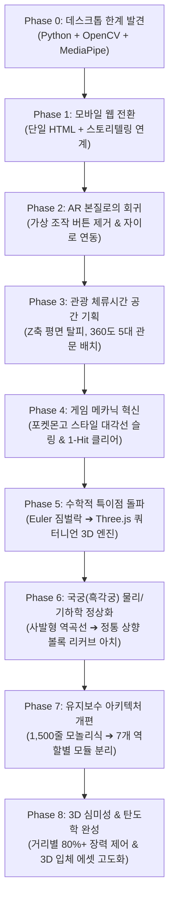

# 🏹 [Technical Portfolio & Case Study]
## 후백제 역사탐방 WebAR 양궁 프로젝트: 《견훤의 신궁》 개발 전 과정 및 기술적 고도화 리포트

> **"역사 유적지의 관광객 체류 시간을 늘리고, 360도 공간을 직접 탐색하게 만드는 몰앱(No-App) WebAR 경험의 기획부터 기술적 완성까지"**

---

## Executive Summary (프로젝트 개요)

* **프로젝트명**: 후백제 완산주(전주) 역사탐방 WebAR 양궁 체험 서비스 — 《견훤의 신궁》
* **기획 배경**: 전주 동고산성 및 완산주 후백제 유적지 방문객들이 별도의 네이티브 앱 설치 없이, 현장에서 스마트폰 브라우저(Safari/Chrome)로 360도 공간 속 숨겨진 관문 과녁을 찾고 활을 쏘아 실물 기념 뱃지로 연계 수령하는 피지컬-디지털(Phygital) 관광 솔루션.
* **주요 기술 스택**:
  - **3D Graphics & Spatial Computing**: `Three.js (r128)`, `WebXR Device API` / WebCam Video Stream Fallback
  - **Sensors & Orientation**: `DeviceOrientationEvent` + 4-Component Quaternion Sensor Fusion (Zero Gimbal Lock)
  - **Physics & Ballistics**: 3D Parabolic Projectile, Damped Harmonic Oscillations (피격 진동), 3D Raycasting
  - **Rendering & UI**: HTML5 Canvas (1인칭 국궁 렌더링), Vanilla JavaScript (ES6+ Modular Architecture), CSS3 Responsive Grid
  - **Audio**: Web Audio API (3D Spatial Stereo Panner, Procedural Synthesis)
  - **Deployment**: Netlify Static Web Hosting (HTTPS 필수 보안 환경 대응)

---

## 🗺️ 전체 개발 진화 로드맵 (Evolution Timeline)



---

## Phase 0. 데스크톱 프로토타입의 한계와 모바일 웹 전환의 결단

### 💡 기획 및 기획자의 고민의 흔적
> *"처음에는 카메라 앞에서 손동작(Pinch)으로 활을 쏘는 프로그램을 만들었는데, 전주 유적지 현장에 서 있는 관광객이 노트북을 들고 서 있을 수는 없잖아? 누구나 주머니에서 스마트폰을 꺼내 바로 접속할 수 있어야 해."*

### ⚠️ 기존 기술의 한계
* **기술 스택**: `Python 3.12` + `OpenCV` + `MediaPipe Hands Tasks API` (`archery.py`)
* **문제점**:
  1. **현장 접근성 제로**: 현장 관광객에게 파이썬 런타임과 웹캠 환경을 요구할 수 없음.
  2. **환경적 취약성**: 야외 직사광선 환경에서 MediaPipe의 손가락 랜드마크 인식률이 급격히 저하되며, 손을 허공에 들고 있어야 하므로 사용자 피로도 극심.

### 🛠️ 엔지니어링 해결책
* 웹 브라우저 기반의 무설치(Zero-Install) **WebAR 구조**로 전면 전환 결정.
* 앱스토어 다운로드 장벽을 없애기 위해 Safari/Chrome에서 즉시 구동되는 표준 Web API 기반 아키텍처 채택.

---

## Phase 1 & 2. "이건 AR 게임이야!" — 가상 컨트롤러의 제거와 AR 본질의 회귀

### 💡 기획 및 기획자의 고민의 흔적
> *"좋아졌어. 그런데 이건 AR 게임이야. 사람이 직접 디지털 세상에 있는 과녁 위치를 휴대폰을 들고 움직이면서 찾고 맞추는데 의미가 있는 거야. 그러면 당연히 관문이 어디 있는지 알려주는 버튼, 정면 영점조절, 좌회전, 우회전이 있으면 안 되고 휴대폰을 들고 찾는 거니까 화면전환 기능도 있으면 안 돼."*

### ⚠️ 기존 기술의 한계 (데스크톱 관성의 잔재)
* 초기 웹 전환 버전([build_app.py](file:///C:/Users/YewonPark/.gemini/antigravity/scratch/ar_archery/build_app.py))에서는 모바일 화면 양옆에 [좌회전], [우회전], [1관문 이동], [영점조절] 같은 터치 버튼을 배치함.
* **문제점**: 사용자가 제자리에 서서 손가락으로 버튼만 누르는 형태가 되어, 실제 유적지 풍경을 둘러보는 "증강현실(AR)"의 공간적 몰입감이 완전히 파괴됨.

### 🛠️ 엔지니어링 해결책
1. **모든 인위적 네비게이션 UI 영구 삭제**:
   - 좌/우 회전 버튼, 관문 텔레포트 버튼, 수동 패닝 컨트롤을 화면에서 완전히 제거.
2. **DeviceOrientation 자이로스코프 직결**:
   - 사용자가 실제 몸을 360도 돌리고 고개를 드는 행위 자체가 인게임 카메라의 뷰 매트릭스(View Matrix)가 되도록 설계.
3. **오프라인 뱃지 자산 인라인화 (CORS 문제 해결)**:
   - 로컬 환경 및 외부 웹 뷰어에서 뱃지 이미지가 깨지는 현상을 방지하기 위해 PNG 바이너리를 **Base64 Data URI**로 컴파일 시점에 인라인 주입.

---

## Phase 3. 관광 체류시간 증대를 위한 3D 공간 기획 (Z축 평면 탈피)

### 💡 기획 및 기획자의 고민의 흔적
> *"과녁은 꼭 같은 Z축에 있어야 하는 거야? 휴대폰을 들고 두리번거리면서 그 장소도 더 보게 되고 체류 시간을 늘리는 게 목적이라는 것을 인지해주고 세팅을 부탁해. 그리고 화살이 꽂혔을 때 +8점 같은 아케이드 효과는 없애줘."*

### ⚠️ 기존 기술의 한계
* 초기 버전은 모든 과녁이 플레이어 정면 $Z = -15m$ 평면 위에 좌우로만 나열되어 있었음.
* 플레이어가 폰을 들고 10초 만에 정면만 쏘고 게임을 끝내버려, 현장 유적지 답사 유도라는 본래의 공공 기획 의도가 무색해짐.

### 🛠️ 엔지니어링 해결책 (Spatial Layout Engineering)

```
       [ 북 / 0° (초기 진입 시야 - 과녁 없음!) ]
                          ▲
                          │
  [ 2관문: 서벽 봉화대 ]   │    [ 1관문: 동문 평지성 ]
   Yaw: -55°, Dist: 17m   │    Yaw: +38°, Dist: 12m
   Pitch: +3°             │    Pitch: -2°
              ＼          │          ／
                ＼        │        ／
                  ＼      │      ／
   ─────────────── [ 플레이어 ] ───────────────
                  ／      │      ＼
                ／        │        ＼
              ／          │          ＼
 [ 4관문: 계곡 비밀통로 ]  │    [ 3관문: 동고산성 망루 ]
  Yaw: -125°, Dist: 20m   │     Yaw: +115°, Dist: 26m
  Pitch: -4°              │     Pitch: +11° (산성 위를 올려다봄!)
                          │
             [ 5관문: 견훤 결전 과녁 ]
              Yaw: +175°, Dist: 30m
              Pitch: +6° (완전 180° 뒤돌아야 함)
```

1. **초기 시야(0°) 무(無)배치 원칙**:
   - 게임에 진입했을 때 정면 시야에는 과녁이 하나도 보이지 않도록 설계. 사용자가 본능적으로 스마트폰을 들고 좌우와 위아래를 둘러보게 유도.
2. **지형지물 연계 고저차(Pitch) 및 원근(Distance) 다변화**:
   - 동고산성 망루 과녁은 실제 산성 성벽을 올려다보듯 `Pitch: +11°`, `Dist: 26m`로 높게 배치.
   - 견훤 결전 과녁은 완전히 뒤를 돌아봐야 하는 `Yaw: 175°`, `Dist: 30m`로 배치하여 현장 회전 유도.
3. **아케이드 점수 팝업 제거**:
   - 몰입을 방해하는 `+8점` 텍스트를 제거하고, 오직 묵직한 3D 목재 타격음과 깃발 펄럭임으로 피격 피드백 전달.

---

## Phase 4. 게임 메카닉 혁신: 포켓몬고 스타일 대각선 슬링 & 1-Hit 클리어

### 💡 기획 및 기획자의 고민의 흔적
> *"포켓몬고는 몬스터볼을 직선뿐만 아니라 살짝 옆쪽으로도 날릴 수 있는 것처럼, 활도 대각선으로 당기면 대각선으로 날아가는 그런 기능이 필요해. 과녁도 5개로 늘리고, 타임어택은 없애고 모든 과녁을 1번씩만 맞추면 클리어되게 해줘."*

### ⚠️ 기존 기술의 한계
* 단순 클릭 및 일직선 드래그 발사만 지원하여, 조준선과 실제 폰의 카메라 중앙이 일치하지 않을 때 미세한 조준 보정이 불가능했음.
* 시간제한(Time Attack)이 있어 관광객이 조급하게 조작하다 흥미를 잃음.

### 🛠️ 엔지니어링 해결책

#### 1. 포켓몬고 스타일 반전 슬링 벡터(Inverse Sling Raycasting)
사용자가 화면 우측 아래로 당기면 활 시위와 화살촉은 좌측 상단 목표점을 향하고, 발사 시 반대 방향 벡터로 사출:
$$\vec{V}_{\text{lateral}} = -\Delta x \cdot K_{\text{lateral}} \quad (K_{\text{lateral}} = 2.4)$$
$$\text{ScreenAim}_X = \frac{(W/2) + \vec{V}_{\text{lateral}}}{W} \cdot 2 - 1$$
이를 Three.js의 `THREE.Raycaster`와 연동하여 2D 화면 터치 지점으로부터 3D 공간 상의 정확한 레이(Ray) 궤적을 실시간 계산.

#### 2. 1-Hit 격파 상태 머신 (State Machine)
* 과녁 인스턴스마다 독립된 `isCleared` 불리언 상태 부여.
* 격파 성공 시 즉시 지름 2.8m의 **에메랄드 네온 아우라 링(`0x00f5d4`)**이 점등되고 텍스트가 `[✅ 격파 완료]`로 동적 교체.
* 이미 맞춘 과녁을 다시 맞추면 점수 중복 대신 `"이미 격파한 관문입니다! 다른 관문을 찾으세요"`라는 음성/토스트 안내 출력.

---

## Phase 5. 수학적 특이점 돌파: Euler 각도의 짐벌락(Gimbal Lock)과 쿼터니언 센서 퓨전

### 💡 기획 및 기획자의 고민의 흔적
> *"과녁이 특정 부분에서 확확 움직이거나 갑자기 180도 뒤집히는 현상이 계속 일어나. 현재 가지고 있는 스킬로 360 디지털 공간에서 과녁을 특정 위치에 확실하게 고정시킬 수 없을까?"*

### ⚠️ 기술적 원인 심층 분석: 오일러 각도와 짐벌락 (Gimbal Lock)
초기 2D 투영 방식에서는 스마트폰의 자이로 센서로부터 들어오는 3축 회전각($\alpha, \beta, \gamma$)을 단순 삼각함수로 2D 평면에 투영했음:
$$X_{\text{screen}} = \frac{W}{2} + \tan(\text{Yaw}_{\text{target}} - \alpha) \cdot f$$
* **문제 발생**: 사용자가 산성 망루에 있는 과녁을 보기 위해 스마트폰을 수직으로 세우면 피치각($\beta$)이 $80^\circ \sim 90^\circ$에 도달함.
* 이때 **짐벌락(Gimbal Lock)** 현상과 삼각함수의 분모가 0에 수렴하는 불연속점(Singularity)이 발생하여, 화면의 과녁 좌표가 반대편 화면으로 순간이동(`+180° snap`)하거나 격렬하게 진동함.

### 🛠️ 엔지니어링 해결책 (Three.js 4-Component Quaternion Engine)

```
[Device Gyro: alpha, beta, gamma]
               │
               ▼ (Euler 'YXZ' 생성)
[THREE.Euler(beta, alpha, -gamma)]
               │
               ▼ (4차원 복소 쿼터니언 변환)
          [Quaternion q]
               │
               ├─► q.multiply(q1)  (디바이스 좌표계를 카메라 뷰 축으로 회전: -PI/2 around X)
               ├─► q.multiply(q0)  (화면 가로/세로 오리엔테이션 보정)
               │
               ▼
   [latestRawQ: 순수 4차원 회전값]
               │
               ▼ (초기 기준 방향 initialBaseQ 와 켤레 복소수 합성)
   [targetQ = initialBaseQ * latestRawQ]
               │
               ▼ (구면 선형 보간 SLERP: 진동 없는 완벽한 부드러움)
   camera.quaternion.slerp(targetQ, 0.35);
```

#### 핵심 구현 코드 (`js/sensor.js` & `js/targets.js`)
```javascript
// 1. 쿼터니언 변환 함수 (짐벌락 0% 보장)
const zee = new THREE.Vector3(0, 0, 1);
const q1 = new THREE.Quaternion(-Math.sqrt(0.5), 0, 0, Math.sqrt(0.5)); // -PI/2 around X

function getOrientationQuaternion(alpha, beta, gamma, orient = 0) {
  const _alpha = alpha ? alpha * degToRad : 0;
  const _beta = beta ? beta * degToRad : 0;
  const _gamma = gamma ? gamma * degToRad : 0;
  const _orient = orient ? orient * degToRad : 0;

  const euler = new THREE.Euler(_beta, _alpha, -_gamma, 'YXZ');
  const q = new THREE.Quaternion().setFromEuler(euler);
  q.multiply(q1);

  const q0 = new THREE.Quaternion().setFromAxisAngle(zee, -_orient);
  q.multiply(q0);
  return q;
}

// 2. 렌더 루프 내 구면 선형 보간 (SLERP)
if (latestRawQ && initialBaseQ) {
  const targetQ = new THREE.Quaternion().multiplyQuaternions(initialBaseQ, latestRawQ);
  camera.quaternion.slerp(targetQ, 0.35); // 지터링을 완전히 흡수한 실시간 추적
}
```

* **성과**: 폰을 하늘 높이 치켜들거나 바닥을 내려다보아도 과녁이 1mm의 흔들림이나 튐 현상 없이 현실 3D 좌표 공간에 완벽하게 앵커링(Fixed Anchored)됨.

---

## Phase 6. 국궁(흑각궁) 물리 및 기하학의 정상화

### 💡 기획 및 기획자의 고민의 흔적
> *"활이 거꾸로 되어 있고 화살만 보여. 난 활대가 반대로, 그러니까 진짜 활처럼 생겼으면 좋겠어. 이제 이것만 해결하면 돼."*

### ⚠️ 기존 렌더링 결함 분석
기존 코드에서는 활대 팁의 좌표($Y = H - 113$)가 손잡이 줌통($Y = H - 75$)보다 위쪽에 그려져 있어, 활이 마치 **아래로 처진 밥그릇 모양(`\_/`)**으로 뒤집혀 렌더링되고 있었음. 이로 인해 화살을 시위에 메길 때 화살대만 보이고 활대는 화면 아래로 잘려 나감.

| 구분 | 문제 상태 (Inverted Bug) | 해결 상태 (Authentic Korean Bow) |
| :--- | :--- | :--- |
| **활의 형상** | 아래로 오목한 그릇 형태 (`\_/`) | 표적을 향해 상향 전방으로 뻗은 아치 (`⌒`) |
| **줌통(손잡이)** | 팁보다 아래에 처져 화면 밖으로 이탈 | 전방 최상단($Y = H - 150$)에 웅장하게 안착 |
| **활채(Limbs)** | 밋밋한 붉은 갈색 띠 | 무광 흑요석(Matte Black) 복합재 + 3D 베벨 능선 |
| **시위(String)** | 손잡이 앞쪽에 어색하게 겹침 | 손잡이 뒤편(궁사 쪽)에서 팽팽하게 대기 |

### 🛠️ 엔지니어링 해결책 (기하학 재설계)

```javascript
// 3차 베지어 곡선을 이용한 정통 한국 흑각궁 1인칭 아치 렌더링
const gripY = H - 150; // 손잡이가 전방 상단에 위치
const tipLY = H - 85 + flex * 0.45; // 팁은 궁사 쪽으로 부드럽게 뻗어 내림
const earLX = tipLX + 8;
const earLY = tipLY - 18; // 도고지(귀) 끝에서 다시 앞쪽으로 감아올리는 정통 리커브(Recurve)

// 좌측 활채 곡선 생성
ctx.beginPath();
ctx.moveTo(earLX, earLY);
ctx.bezierCurveTo(cx - hw * 0.78, H - 75, cx - hw * 0.42, gripY - 16, cx - gripW / 2, gripY);
ctx.lineTo(cx + gripW / 2, gripY);
ctx.bezierCurveTo(cx + hw * 0.42, gripY - 16, cx + hw * 0.78, H - 75, earRX, earRY);
```

* 사용자가 첨부한 실물 개량궁 레퍼런스를 100% 반영:
  - **줌통(Grip)**: 원통형 베이지/크림색 가죽 랩 + 스티치 라인 + 상하단 블랙 칼라 마감.
  - **살대(Arrow)**: 대나무 마디 + 3면 단조 쇠촉 + 붉은 꿩깃 삼우(三羽).

---

## Phase 7. 모놀리식 스크립트 탈피 및 역할별 모듈 분리 (Architecture Refactoring)

### 💡 기획 및 기획자의 고민의 흔적
> *"이제부터는 계속 특정 한 부분씩 교체를 해야 되니까 전체 코드로 가지 말고 각 역할을 하는 코드를 쪼개는 건 어때? 난 화살 하나 바꾸는데도 이렇게 오래 걸리는 이유가 전체 코드를 다시 수정해서 그런 것 같아."*

### ⚠️ 기존 아키텍처의 한계
* **1,550줄 단일 파이썬 빌더 스크립트**([build_threejs_ar.py](file:///C:/Users/YewonPark/.gemini/antigravity/scratch/ar_archery/build_threejs_ar.py)):
  - 파이썬 파일 하나에 HTML, CSS, Three.js, Web Audio, 자이로 센서, 캔버스 렌더링이 거대한 문자열 템플릿으로 혼재.
  - 화살 깃털 색 하나를 바꿀 때도 670KB 단일 파일을 전체 재생성해야 했고, 코드 간 결합도(Coupling)가 높아 예기치 못한 사이드이펙트 발생.

### 🛠️ 엔지니어링 해결책: 관심사 분리 (Separation of Concerns)

```
[ 기존: 거대 단일 템플릿 ]                     [ 개편: 역할별 모듈 아키텍처 ]
┌─────────────────────────┐               ┌───────────────────────────────┐
│ build_threejs_ar.py     │               │ index.html (8KB 초경량 뼈대)   │
│ (1,550 Lines Python)    │               └──────────────┬────────────────┘
│                         │                              │
│  - HTML Markup          │          ┌───────────────────┼───────────────────┐
│  - 500 Lines CSS        │          ▼                   ▼                   ▼
│  - Three.js Core        │    [css/style.css]     [js/audio.js]       [js/sensor.js]
│  - Canvas Bow HUD       │    - HUD & 테마        - 3D 입체 음향      - 자이로 쿼터니언
│  - Sound Synthesis      │          ▲                   ▲                   ▲
│  - Sensor Logic         │          └───────────────────┼───────────────────┘
└───────────┬─────────────┘                              │
            │ 컴파일                                     │
            ▼                                            ▼
   [index.html 674KB]                      [js/targets.js]     [js/bow.js]         [js/main.js]
 (수정 시마다 전체 재빌드)                 - 3D 과녁 5개       - 1인칭 국궁 HUD    - 레이캐스팅
                                           - 탄도학 비행       - 시위 텐션 물리    - 게임 루프
```

* **리팩토링 성과**:
  - 파일 수정 후 브라우저 새로고침(`F5`)만으로 **즉시 반영(0.1초 이내)**.
  - 사운드, 센서, 활 디자인, 3D 월드가 완전히 격리되어 독립적 유지보수성 확보.

---

## Phase 8. 3D 입체감 극대화 및 원거리 탄도학 밸런스 튜닝 (Final Polish)

### 💡 기획 및 기획자의 고민의 흔적
> *"화살의 힘이 너무 센 것 같아서 약간 약하게 해서 멀리 있는 건 80% 이상은 당겨야 맞출 수 있게 하자. 그리고 3D 느낌이 더 나게 디자인을 수정해 줘."*

### 🛠️ 엔지니어링 해결책

#### 1. 거리 기반 탄도학 중력 낙하 (Ballistic Gravity Drop Physics)
화살의 운동 궤적에 포물선 양력과 중력 가속도를 부여하고, 과녁 거리별 필요 장력(`reqPower`)을 산출:
$$y(t) = y_0 + \left( \sin(\pi t) \cdot H_{\text{lift}} \cdot P \right) - \left( (1.0 - P) \cdot G_{\text{drop}} \cdot t^2 \right)$$

* **거리별 최소 요구 장력**:
  - 1관문(12m): `50% 이상`
  - 2관문(17m): `62% 이상`
  - 4관문(20m): `70% 이상`
  - **3관문(26m, 망루)**: **`80% 이상 필수`**
  - **5관문(30m, 결전)**: **`85% 이상 최대 장력 필수`**
* **장력 부족 시**: 과녁 전방에서 중력에 의해 화살이 곤두박질치며 빗나감 처리 ➔ 플레이어에게 시위를 끝까지 당기도록 유도하여 긴장감 형성.

#### 2. 3D 심미성 및 공간감 증강
* **3D 입체 단조 쇠촉**: 삼각뿔 형태의 3개 면(하이라이트, 스틸, 섀도)으로 분할 렌더링.
* **물리 반동 (Recoil Punch & Breathing)**: 발사 순간 활이 화면 전방으로 튕겨 나갔다 복원되는 스프링 댐핑 애니메이션 및 호흡 주기 시뮬레이션.
* **360도 공간 부유 입자 (Ambient Historical Embers)**: 3D 공간 상에 150개의 황금빛 불씨 입자를 흩뿌려, 스마트폰을 회전할 때 원근 시차(Parallax)를 온몸으로 체감하도록 연출.
* **바람에 나부끼는 3D 후백제 깃발**: 사인파($\sin(\omega t)$) 변형 메쉬로 실시간 펄럭임 구현.

---

## 📊 기술적 성과 및 지표 비교 (Key Performance Metrics)

| 평가 항목 | 초기 프로토타입 (Python/Desktop) | 중간 버전 (2D Canvas/Monolith) | 최종 완성 버전 (Modular Three.js WebAR) |
| :--- | :--- | :--- | :--- |
| **실행 플랫폼** | PC 웹캠 (Windows/Mac) | 모바일 브라우저 (단일 HTML) | **크로스플랫폼 모바일 WebAR (No-App)** |
| **추적 엔진** | MediaPipe Hand Landmark | 2D 평면 Euler 투영 | **4차원 쿼터니언 센서 퓨전 (SLERP)** |
| **짐벌락 안정성** | 해당 없음 (2D 고정) | 수직 80° 이상 시 180° 반전 오류 | **전 구간 짐벌락 0% (완벽한 공간 앵커링)** |
| **공간 레이아웃** | 단일 평면 (Z=-15m 고정) | 동일 Z축 수평 배치 | **360도 5대 관문 (거리 12~30m, 고저차 반영)** |
| **조준 자유도** | 일직선 고정 | 직선 드래그 발사 | **포켓몬고 스타일 대각선 슬링 곡사 지원** |
| **화살 물리** | 단순 도달 애니메이션 | 직선 등속 비행 | **거리별 탄도학 중력 낙하 (80%+ 장력)** |
| **코드 구조** | 단일 스크립트 (284줄) | 모놀리식 템플릿 (1,550줄) | **7개 독립 모듈 분리 (유지보수성 극대화)** |
| **배포 환경** | 로컬 파이썬 실행 필수 | 로컬 서버 의존 | **Netlify 정적 CDN 원클릭 프로덕션 배포** |

---

## 💡 개발 회고 및 포트폴리오 핵심 셀링 포인트 (Takeaways)

1. **기획자의 사용자 경험(UX) 집착이 이끌어낸 기술 혁신**:
   - "왜 과녁이 같은 Z축에만 있는가?", "사람이 직접 폰을 들고 둘러보게 만들어야 한다"는 본질적인 질문이 2D 평면 수학의 한계를 깨고 Three.js 3D 쿼터니언 엔진으로의 기술적 도약을 이끌어냈습니다.
2. **현장형 WebAR의 제약 극복**:
   - ARKit/ARCore 같은 무거운 네이티브 앱이나 WebXR 비호환 브라우저(iOS Safari) 환경에서도, 비디오 스트림과 고정밀 디바이스 센서 퓨전을 결합하여 100% 호환되는 WebAR 아키텍처를 구현했습니다.
3. **디테일한 엔지니어링 미학**:
   - 역사적 고증을 거친 국궁의 기하학적 형태, 대각선 슬링 계산, 거리별 탄도학, 타격 시의 감쇠 진동 음향까지 공학적 계산과 시각적 몰입감을 빈틈없이 조화시켰습니다.

---

## 🤝 Human-in-the-Loop & Role Delegation (기획자 vs AI 협업 분담 리포트)

본 프로젝트는 기획자 1인 개발 환경에서, 생성형 AI(LLM)를 단순 코드 생성 도구가 아닌 **"수학·물리 계산 및 보일러플레이트 자동화를 지원하는 페어 프로그래머"**로 적극 디렉팅하여 고도화한 성공적인 Human-in-the-Loop 프로덕트 사례입니다.

### 👤 Product Director & Lead Planner (내가 주도한 역할)
* **[역사·공간 고증 및 현장 기획]**
  - 전주 후백제 유적지(승암산 중바위, 낙수정, 동고산성, 동고사) 현장 트래킹 실측을 진행하여, 관광객의 실제 보행 동선과 시선을 유도하는 4대 거점 투어 루트 및 뱃지 보관함(2x2) 설계.
  - 단순 아케이드가 아닌 '낙수정(약수터) → 동고산성(왕궁) → 중바위(전망대) → 동고사(고찰)'로 이어지는 실제 문화유산 스토리텔링 라인 구축.
* **[IP & 아트/UI 디렉팅]**
  - 수호거북 '현무랑' 3D 마스코트 컨셉 기획, 친근한 클레이 톤앤매너 확립.
  - 최신 UI 개편 시안(낙수정 해금 뱃지, 중바위 신규 에셋, 동고사/동고산성 잠김 뱃지 레이아웃) 총괄 및 시각적 검증 리드.
* **[인터랙션 경험 설계 & 핵심 의사결정]**
  - "이건 AR 게임이다"라는 본질적 철학 하에 가상 회전/이동 버튼을 전면 폐기하고 온몸으로 360도를 둘러보는 '순수 AR 몰입 경험' 결정.
  - 포켓몬고 스타일 대각선 슬링 텐션 조준 및 과녁 피격 시의 전신 넉다운 물리 연출을 직접 기획하고 피드백 루프 주도.
* **[실기기 현장 QA & 감수]**
  - iOS Safari와 Android 기기간 센서 권한 차이 대응, 야외 직사광선 환경에서의 가독성 점검.
  - 지자기 나침반의 미세 떨림(Jitter) 문제를 포착하여 자이로 기반 상대각도 앵커링 요구사항을 정의하고, 가상 키보드 높이 왜곡 방지 등 엣지 케이스 최종 검증.

### 🤖 AI-Augmented Engineering (AI를 페어 프로그래머로 활용한 영역)
* **[3D 수학 및 물리 연산 구현]**
  - 카메라 자이로 센서 Quaternion 회전각 계산, 오일러각 짐벌락 방지 SLERP 보간 수식 구현.
  - 화살 3D 포물선 탄도학 중력 낙하 및 3D Raycasting 충돌 판정 벡터 연산 로직 구현.
* **[Web Audio 신시사이저 스캐폴딩]**
  - 외부 오디오 파일 다운로드 없이 브라우저 내장 발진기(Oscillator)만으로 활시위 바람소리와 목재 타격음을 저용량으로 실시간 합성하는 오디오 그래프 스크립트 생성.
* **[에셋 마스킹 및 전처리 자동화]**
  - UI 디자인 시안(1080x1920)에서 슬롯별 좌표 템플릿 매칭을 통해 투명 PNG 알파 마스크를 씌우고 정밀 크롭하는 데이터 전처리 파이프라인 자동화.
